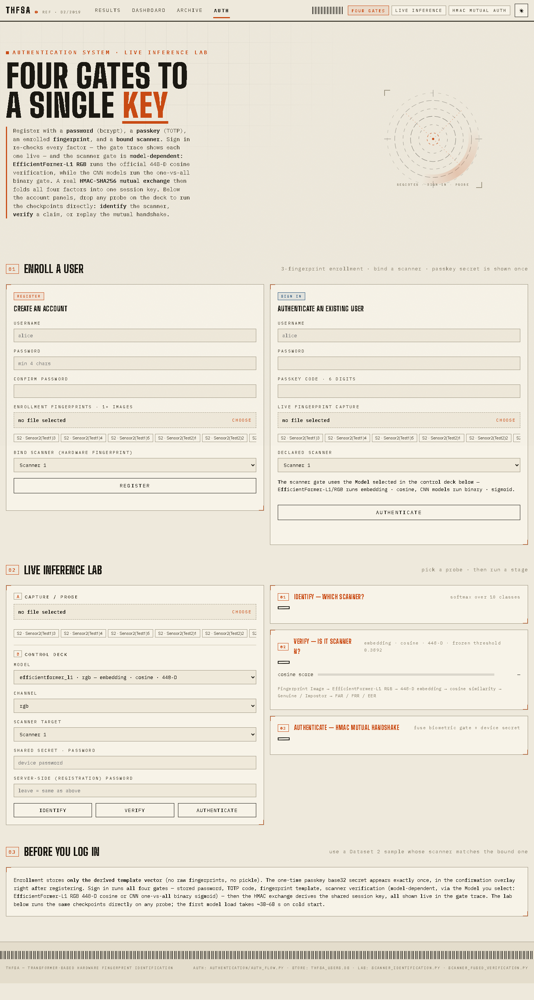
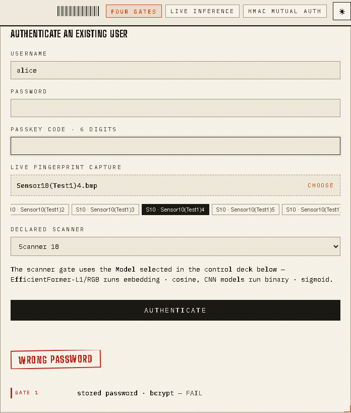
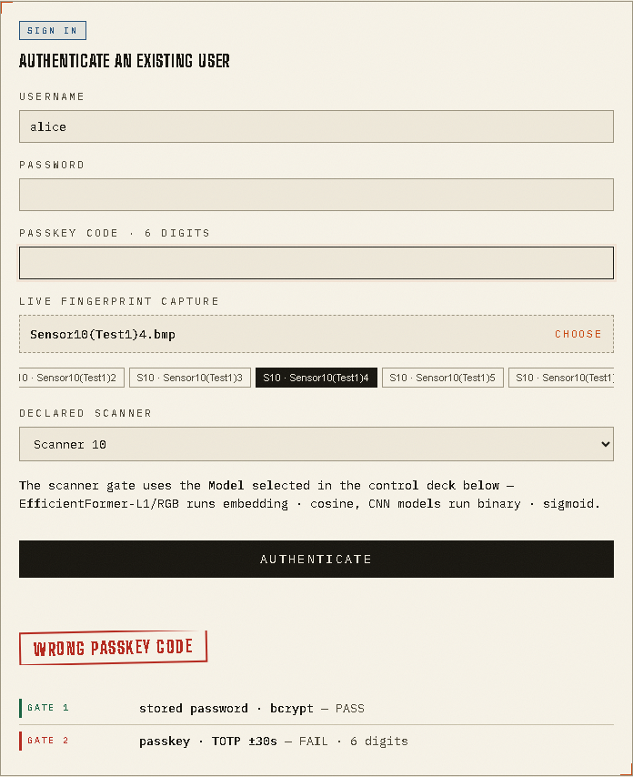
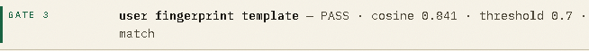
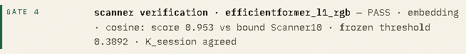
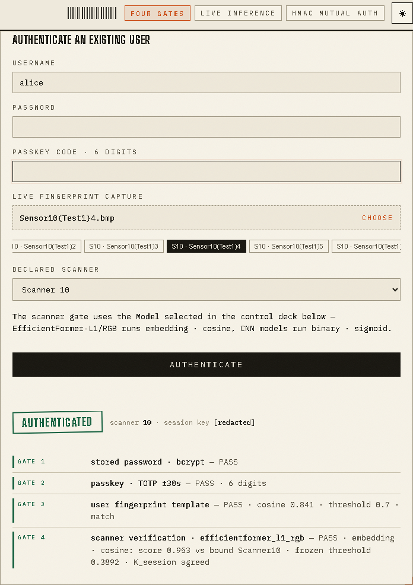

# Transformer-Based Hardware Fingerprint Identification for Secure Fingerprint Scanner Authentication

## Project status

THFSA is a research prototype with a PyTorch/TIMM scanner-identification and verification pipeline, a Flask dashboard, and a working multi-factor authentication demo. The source code and tests are included here. Fingerprint datasets and trained model checkpoints are not distributed in this repository; you must supply them locally for training, inference, and the full authentication flow.

The browser demonstration used stored Dataset 2 fingerprint images. It did not connect to or test a physical R307 scanner. This project is not production-ready: the user fingerprint factor is a derived-vector cosine matcher, the dataset is limited, and several security and generalization studies remain planned.

## Overview

Fingerprint images contain sensor-specific patterns that can support identifying the scanner that captured them. This project trains image classifiers to identify one of ten R307 scanners and evaluates whether a sample matches a claimed scanner. It compares six CNN baselines with eight Transformer or hybrid architectures, using separate grayscale and RGB experiments.

A Flask application presents the measured results, model inventory, inference tools, and an authentication demonstration. Scanner identity is a hardware-classification task; it is not a classifier for a person's identity.

## Implemented features

- PyTorch/TIMM training and evaluation for 14 registered architectures.
- Multiclass scanner identification and binary one-vs-all scanner verification.
- Dataset 1 train/validation split and Dataset 2 final test protocol, with CSV result tables.
- A Flask dashboard, final-results pages, archive inventory, and authentication/inference page.
- User enrollment with a bcrypt password hash, TOTP secret, derived fingerprint template, and bound scanner.
- Four recorded sign-in gates: password, TOTP, user fingerprint-template match, and scanner verification. The HMAC session-key agreement is checked within the fourth gate.
- Five standalone Python test scripts under `tests/`.

## Architecture

```text
Fingerprint images
  ├─ training: Dataset 1 → per-scanner 70/30 train/validation → CNN/Transformer checkpoints
  └─ evaluation: Dataset 1 validation + Dataset 2 test → measured CSV tables

Browser → Flask (`web/app.py`)
  ├─ dashboard/results/archive pages → result tables, metrics, and available model files
  ├─ inference APIs → scanner identification or scanner verification
  └─ `/auth` → bcrypt → TOTP → user-template cosine match → scanner verification
                                                  └─ HMAC session-key agreement
```

The HMAC exchange is required for a successful login, but its result is folded into gate 4, so the live trace contains four entries.

## Technology

- Python, PyTorch, TIMM, NumPy, Pillow, scikit-learn, and Matplotlib
- Flask for the local web application
- bcrypt and PyOTP for password hashing and RFC 6238 TOTP
- SQLite for the local user store
- Playwright with Chromium was used for the authentication screenshots; browser automation is not required to run the application.

## Authentication workflow

Registration stores a bcrypt password hash, a TOTP secret, a derived 64×64 fingerprint-vector template, and the user's scanner binding. The raw fingerprint image is not stored by the template module.

Sign-in checks:

1. The submitted password against its bcrypt hash.
2. The six-digit TOTP code within the implementation's accepted time window.
3. The uploaded/sample fingerprint against the enrolled vector template using cosine similarity.
4. Scanner verification against the enrolled scanner. The default EfficientFormer-L1 RGB path uses a 448-dimensional embedding and frozen cosine threshold; supported CNN binary paths use per-scanner thresholds. A mutual HMAC session-key agreement is also required within this gate.

The template matcher is an academic prototype, not a production minutiae or liveness system. The demo uses image files; physical scanner capture is not implemented in the verified browser flow.

## Model experiments and data protocol

The registry in `src/config.py` contains six CNN baselines:

- EfficientNet-B3, MobileNetV2, ResNet-50, ResNet-152, VGG16, and LeNet-5.

It also contains eight Transformer or hybrid architectures:

- ViT-B/16, Swin-Tiny, DeiT-Small, ConvNeXt-Tiny, TinyViT-5M, MobileViT-XS, EfficientFormer-L1, and PiT-Ti.

Grayscale and RGB modes are separate experiments. Most registered runs use the configured from-scratch setup; the official EfficientFormer-L1 RGB run is an explicitly documented pretrained exception. Dataset 1 supplies scanner-labeled training and validation images. Dataset 2 is reserved for the final unseen-user test on known scanner hardware. It is not an unseen-hardware test.

The measured tables under `results/tables/` are the result records. Graphs, training logs, predictions, datasets, and checkpoints are generated or separately supplied assets and are not included in this repository. The table files should be backed up before running evaluation commands that write to the same paths.

## Installation

Python 3.10 or newer is recommended. From a terminal:

```powershell
git clone https://github.com/eswarsamanthula/Transformer-Based-Hardware-Fingerprint-Identification-for-Secure-Fingerprint-Scanner-Authentication.git
cd Transformer-Based-Hardware-Fingerprint-Identification-for-Secure-Fingerprint-Scanner-Authentication
py -m venv .venv
.venv\Scripts\Activate.ps1
python -m pip install --upgrade pip
python -m pip install -r requirements.txt
```

On macOS/Linux, activate the environment with `source .venv/bin/activate`. PyTorch installation can be platform-specific; use the appropriate PyTorch build for your CPU/GPU environment if the default package install is unsuitable.

## Configuration and security

`.env.example` lists the environment variables read by the project. The application does **not** automatically load `.env` files; set variables in your shell or process manager. Do not commit a filled `.env` file or paste real secrets into source code.

- `THFSA_SECRET_KEY` configures Flask's signing key. The source has a development fallback; set a long, random local value before using the app beyond a disposable local demo.
- `THFSA_DB_PATH` optionally selects the SQLite user-store path. The default is `authentication/data/thfsa_users.db`.
- `THFSA_DATA_ROOT` and `THFSA_TEST_DATA_ROOT` optionally override the two dataset locations. Use absolute paths when overriding them so commands work from both the repository root and `src/`.
- The HMAC server key is generated locally at `authentication/server_secret.bin` on first use. It is ignored by Git. Keep it private and back it up securely if you need to retain accounts; replacing it invalidates the stored server-side values for those users.

Example PowerShell setup (replace the placeholder with a locally generated secret):

```powershell
$env:THFSA_SECRET_KEY = "replace-with-a-long-random-local-value"
# Optional: use absolute paths for data on this machine.
$env:THFSA_DATA_ROOT = "C:\path\to\dataset\Dataset1\Fingerprint"
$env:THFSA_TEST_DATA_ROOT = "C:\path\to\dataset\Dataset2\Fingerprint_of_Test1_and_Test2"
```

## Dataset and checkpoint setup

The raw fingerprint data is intentionally not committed. It contains biometric images and is too large and sensitive to distribute in this source repository. Obtain it only from an authorized project/data provider and place it in this layout:

```text
dataset/
├─ Dataset1/Fingerprint/Sensor1/*.bmp
├─ ...
├─ Dataset1/Fingerprint/Sensor10/*.bmp
└─ Dataset2/Fingerprint_of_Test1_and_Test2/*.bmp
```

Dataset 1 is expected to contain 2,019 BMP images across ten scanner folders. Dataset 2 is expected to contain 200 BMP images named `Sensor<n>(Test<m>)<k>.bmp`. Dataset 2 is reserved for final evaluation and must not be used for training or validation.

Trained `.pt` weights are also omitted: the local checkpoint tree is several gigabytes and individual files exceed ordinary Git hosting limits. Use the training commands below to create checkpoints under `checkpoints/cnn/` and `checkpoints/transformer/`. The default authentication scanner verifier needs the EfficientFormer-L1 RGB multiclass checkpoint and its Dataset 1 validation data; the CNN binary path also needs its per-scanner checkpoints and the included threshold table. No checkpoint download source is documented here, so do not assume pretrained weights are available from this repository.

## Run the application

From the repository root, after installing dependencies and supplying any required model/data assets:

```powershell
python web/app.py
```

Open <http://127.0.0.1:5001/>. The main routes are `/`, `/results`, `/archive`, and `/auth`. The `/login` and `/infer` routes redirect to `/auth`. The results pages can load the included CSV records without model checkpoints; live inference and the complete scanner-authentication path require the corresponding model assets and data.

## Train and evaluate

The training scripts use paths relative to `src/`; run these commands from that directory after placing the datasets locally:

```powershell
cd src
python dataset.py
python train.py --model tinyvit_5m --channel grayscale
python train.py --model all --channel both
python train.py --model vgg16 --channel grayscale --mode binary
python test.py --model all --channel both
python test.py --model vgg16 --channel grayscale --mode binary
```

Binary training creates one one-vs-all checkpoint per scanner for the selected model/channel. Training can be long, especially for `--model all`. Evaluation writes result CSVs under `results/tables/`; use `--out_csv` to preserve existing records. Training writes checkpoints and per-epoch logs, which are ignored by Git.

## Tests

The project uses standalone Python scripts with assertions; it does not configure pytest. From the repository root, run:

```powershell
python tests/test_user_biometric.py
python tests/test_scanner_identification_binary.py
python tests/test_scanner_fused_verification.py
python tests/test_auth_web.py
python tests/test_authentication_flow.py
```

`test_auth_web.py` uses deterministic scanner-gate doubles for the HTTP route checks. The fused-verifier and full authentication-flow checks require the relevant data and model checkpoints. These automated checks are separate from the manual browser demonstration represented by the screenshots.

## Results and project documentation

Authoritative measured tables are in `results/tables/`; selected presentation CSVs are in `results/metrics/`. Regenerable graphs, prediction caches, and training logs are excluded. The scripts in `experiments/` contain the available graph, verification, cache, and evaluation helpers. Methodology, data protocol, authentication, verification, status, and web-guide notes are under [`docs/current/`](docs/current/).

The project documentation cites the base paper as Nimmy et al., “Robust Authentication: Leveraging Hardware Fingerprints and AI to Enhance Security Against Spoofing,” *IEEE Access* (2025). Full citation metadata such as DOI or issue details was not present in the project documents reviewed.

## Repository structure

```text
.
├─ authentication/       # authentication, biometric, scanner-verification modules
├─ checkpoints/          # local model weights; not tracked
├─ dataset/              # local fingerprint data; not tracked
├─ docs/current/         # methodology and implementation notes
├─ experiments/          # evaluation and result-generation helpers
├─ logs/                 # generated training logs; not tracked
├─ results/metrics/      # selected measured summary CSVs
├─ results/tables/       # authoritative measured CSV tables
├─ screenshots/          # six browser-captured authentication screens
├─ src/                  # model registry, data loading, training, evaluation
├─ tests/                # standalone assertion-based checks
├─ web/                  # Flask app, templates, JavaScript, CSS
├─ .env.example
├─ .gitignore
├─ requirements.txt
└─ README.md
```

## Demonstration screenshots

### Login page



The page shows the actual THFSA authentication screen and its sign-in controls.

### Incorrect password rejection



The app rejects an incorrect password at the bcrypt gate and shows the failed gate trace.

### Invalid TOTP rejection



The app accepts the password check and rejects an invalid TOTP code; no code is shown.

### Fingerprint-template matching



This cropped live gate trace shows a successful enrolled-template cosine match.

### Scanner verification



This live gate trace shows the EfficientFormer-L1 RGB scanner verification result and frozen threshold.

### Successful authentication



The sign-in screen shows all four gates passing; the transient session key is redacted.

## Limitations and future work

- The reported browser flow used stored Dataset 2 images, not a physical R307 scanner.
- Dataset 2 tests unseen users on known scanner models; no cross-sensor/unseen-hardware evaluation is documented.
- The derived-vector cosine template is a research prototype, not a robust minutiae matcher or liveness detector.
- Multi-seed uncertainty estimates, spoof/liveness testing, latency/FLOPs measurements, and a cross-sensor evaluation remain planned work.
- Training and inference need local fingerprint data and checkpoints that are deliberately absent from GitHub.
- A passing demo is not evidence of production security or deployment readiness.

## Security notes

Use synthetic or authorized test data for local experiments. Keep database files, TOTP secrets, server HMAC keys, passwords, and session values out of source control and screenshots. The included screenshot set uses test data and blanks credential fields; its session key is redacted. Review the security design before exposing the Flask development server to a network.
